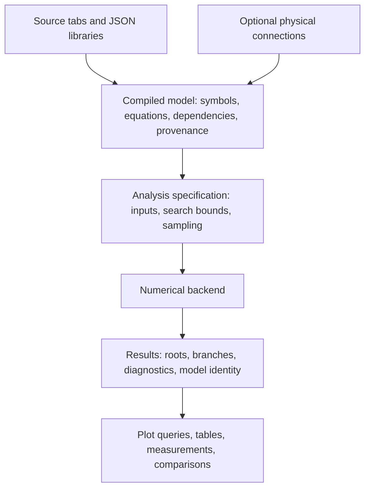

# Project direction: nonlinear solving, reusable models, and interactive graphs

Research date: 2026-10-31. Code reviewed: `9a2ae6f`. Validation: all 433 existing tests passed across 35 test files. This review adds no application changes and starts no server. External comparisons use project documentation, language specifications, and original project source. They are architectural comparisons, not comparative performance benchmarks. Recommendations below are my assessment rather than claims made by those projects.

## 1. The strongest direction

Develop this into a **browser engineering equation workbench**: enter equations, assemble reusable models, explore solution families, compare data, and inspect the mathematics behind each result. Circuits are an excellent first application, but the same foundation can serve mechanics, thermal networks, nonlinear constraints, and inverse design.

The most useful architectural comparison is a combination of **EES's engineering equation workflow, Modelica's reusable physical models, and Desmos's direct interaction**. EES already combines coupled equations, units, parameter studies, and plots; Modelica already combines equations with object-oriented reuse. Those precedents validate the direction, while also showing that reusable elements alone are not a new capability relative to established tools. [EES overview](https://fchartsoftware.com/ees/), [Modelica inheritance](https://specification.modelica.org/maint/3.6/inheritance-modification-and-redeclaration.html).

The opportunity is the experience: a portable browser file, transparent editable equations, immediate graphing, reusable models, and understandable numerical feedback. Making a custom transistor law easy to inspect and vary is a plausible advantage for exploratory design. Matching detailed semiconductor models, convergence behavior, or analysis coverage of mature circuit simulators would require separate evidence and substantial additional work.

## 2. What the code supports today

The implementation contains considerably more than a basic Newton iteration and a chart. Preserve its existing safeguards and reductions when changing the architecture.

| Area | Current capability | Practical boundary and code evidence |
|---|---|---|
| Mathematical language | Safe expression AST, implicit equalities, inferred unknowns, explicit parameters/guesses, engineering suffixes, lazy conditionals, validity checks | Scalar real/complex quantities; no user-defined functions, arrays, physical dimensions, or general symbolic equation solving. [Parser](../src/core/expression.ts), [inference](../src/core/inference.ts). |
| Algebraic compilation | Direct evaluation of complete assignment chains; affine direct solution; partial assignment elimination and bounded linear isolation; reconstruction of eliminated quantities | Bounded reductions rather than a general symbolic compiler or a full structural decomposition into nonlinear blocks. [Assignments](../src/core/assignments.ts), [preprocessing](../src/core/preprocessing.ts). |
| Nonlinear solving | Variable/residual scaling, finite-difference Jacobians, damped Newton, backtracking, regularized fallback, correction-size convergence checks | Dense matrices and dense elimination. Derivatives are numerical, and regularization explicitly forms normal equations. [Solver](../src/core/solver.ts#L103). |
| Root discovery | Deterministic multistart, deduplication, neighboring-sample seeds, multiple roots and branch segments | Finite heuristic search; it cannot prove completeness, uniqueness, or absence of solutions. [Root search](../src/core/solver.ts#L198). |
| Constraints | Conditions filter roots; simple inclusive bounds with fixed-input expressions also guide the search | General inequalities are not constrained optimization, complementarity solving, or a guarantee that a feasible root will be discovered. [Bounds](../src/core/constraints.ts). |
| Complex problems | Complex unknowns represented by real components, real parameters, explicit real plot projections | Complex algebraic solving is not an automatic transistor small-signal analysis. [Complex solver](../src/core/complexSolver.ts#L99). |
| Studies | Parameter sweeps, additional slice dimensions, centered computation order, live previews, cancellation, bounded message transfer and retained-data budget | The UI requires a plotted sweep for numerical solving. There is no independent solve-once workflow, fold-following continuation, named study collection, transient integrator, or user-facing fitting mode. [App lifecycle](../src/App.tsx#L180), [sweep loop](../src/core/solver.ts#L212), [worker](../src/core/worker.ts). |
| Graphs | Per-curve real X/Y expressions, parametric curves, multiple branches, pan/zoom, automatic/manual bounds, reference lines, SVG export, point inspection | One pair of linear axes; no linked panes, log display axes, equal-aspect control, bulk results table/CSV, measurements, or viewport-based implicit curves. [Plot](../src/Plot.tsx), [traces](../src/plotTraces.ts). |
| Reusable models | Loadable JSON types, scoped `M1.member` symbols, independent defaults, lazy activation, instance overrides, model equations visible in the library | Flat templates. No `extends`, nested components, model arrays, typed physical connectors, or automatic conservation equations. [Elements](../src/core/elements.ts#L8). |
| Diagnostics | Counts, solver dimensions, sample failures, residuals, on-demand Jacobians, fixed/folded constants, source errors | Equal counts are checked; structural matching, numerical rank estimates, conflict localization, and persistent generated-equation source maps are missing. [Diagnostics](../src/core/diagnostics.ts), [constants](../src/ConstantsPanel.tsx). |
| Portability | Standalone offline HTML; source-preserving workspace JSON with element definitions | One locally saved workspace. No named run archive or numerical dataset exchange workflow. [Workspace format](../src/core/workspace.ts). |

### Important integration gap: implemented helpers are not necessarily shipped behavior

There is already tested infrastructure for separating numerical results from graph expressions: `solverConfiguration`, `solveKey`, and `projectSweep` in [projection.ts](../src/core/projection.ts#L23). [sampleReuse.ts](../src/core/sampleReuse.ts#L46) also supports bounded reuse of compatible samples at exact coordinates.

However, the current App does not call the projection helpers or pass a reuse source. Its [input key](../src/App.tsx#L46) includes axes, and its [runner call](../src/App.tsx#L199) passes only configuration and delay. [SweepRunner](../src/core/sweepRunner.ts#L33) uses sample reuse only when its optional argument is supplied.

Consequently, pure plot-expression edits can schedule a fresh numerical run in the current UI. Completing this integration is an unusually concrete near-term improvement. Graph-bound edits, transition-only edits, and selecting already computed slices already have display-only paths; those should remain intact.

### Limits do not establish scalability

The code permits 50,000 main samples, 10,000 samples per additional dimension, and 250,000 combined sample positions, with a conservative 1,000 MiB retained-data budget. These are resource limits, not measured assurances about responsiveness. [Limits](../src/core/sweepLimits.ts).

The 100-declaration check also does not necessarily cap inferred numerical unknowns. Diagnostics skips some preparation above 100 inferred/declared unknowns, while inference can introduce additional symbols. Dense solver scratch space, browser rendering, and worker transfers are distinct from retained result storage. Actual supported model sizes should be established by benchmarks.

## 3. What a broad set of other projects teaches

This is a representative comparison across several problem classes, rather than an exhaustive catalog of every simulator or grapher.

| Project or family | Approach worth studying | Application to this project |
|---|---|---|
| **Desmos** | Expression-list interaction, sliders, tables, regression, direct graph interaction, and accessible tracing. Its current guide also documents Complex Mode. [Official guide](https://help.desmos.com/hc/en-us/articles/202529279-Desmos-Graphing-Calculator-User-Guide). | Minimize the edit-to-result loop. Add completion, local visibility/style controls, and discoverable actions. Complex arithmetic alone is not a differentiator. |
| **GeoGebra** | Curves are mathematical objects with point, tangent, intersection, derivative, length, and curvature operations; polynomial implicit curves can be entered directly. [Curves manual](https://geogebra.github.io/docs/manual/en/Curves/). | Let users measure and interrogate curves. Add explicit implicit-curve graphing without conflating it with solving a square coupled system. |
| **EES** | Engineering quantities, nonlinear equations, unit checking, parameter studies, reusable functions, regression, uncertainty, and plots are integrated. [Overview](https://fchartsoftware.com/ees/), [parametric tables](https://fchart.com/ees/eeshelp/1s9tida.htm). | A particularly close product precedent. Numerical tables, units, design studies, sensitivities, and measured-data fitting broaden usefulness beyond electronics. |
| **ngspice** | Circuit analysis types and operating-point convergence aids are explicit. AC analysis linearizes nonlinear devices about a DC bias. [Manual](https://ngspice.sourceforge.io/docs/ngspice-47-manual.pdf). | Establish distinct analysis semantics and a controlled rescue strategy for difficult operating points. Compare matched models before claiming comparable results. |
| **Xyce** | Its published mathematical formulation separates circuit topology, device contributions, nonlinear equations, and linear algebra. [Official formulation, 2004](https://xyce.sandia.gov/files/xyce/Xyce_Math_Formulation.pdf). | Circuit-aware compilation can coexist with a general residual solver. The linked document is a historical architectural source, not a description of a new release. |
| **CircuitJS / Falstad** | Browser interaction includes animated electrical state. Internally it assembles node equations, stamps devices, and treats dynamic components through integration-related models. [Internals](https://raw.githubusercontent.com/sharpie7/circuitjs1/master/INTERNALS.md), [simulator introduction](https://www.falstad.com/circuit/). | Borrow semantic feedback and inspectable device state. A future schematic should be another view of the same model. Browser execution itself is already established elsewhere. |
| **Qucs-S** | Simulation datasets are separate from diagrams; results can have multiple graph/table views and numerical export. Tuning is a scheduling workflow around simulations. [Results](https://qucs-s-help.readthedocs.io/en/latest/overview/displaying-results.html), [tuning](https://qucs-s-help.readthedocs.io/en/latest/overview/simulation-types/tuning-mode.html). | Retain numerical data independently of presentation. Add linked panes, tables/CSV, and explicit control over which studies update interactively. |
| **Modelica / OpenModelica** | Equation-based classes, inheritance, and typed connectors support reusable physical systems. Connections generate potential equalities and flow conservation. [Connections](https://specification.modelica.org/maint/3.6/connectors-and-connections.html), [inheritance](https://specification.modelica.org/maint/3.6/inheritance-modification-and-redeclaration.html). | This is the closest precedent for the proposed object-oriented direction. Adopt useful semantics incrementally rather than reproducing an entire language. |
| **ModelingToolkit** | Hierarchical composition, scoped symbols, structural transformations, and observable reconstruction prepare models for numerical backends. [Composition](https://docs.sciml.ai/ModelingToolkit/stable/basics/Composition/), [acausal components](https://docs.sciml.ai/ModelingToolkit/stable/tutorials/acausal_components/). | Evolve the existing AST and elimination work into a compiled model graph with provenance. Preserve internal quantities for plotting after reduction. |
| **SolveSpace** | Constraint modeling exposes degrees of freedom and can identify constraints whose removal would restore consistency. [Constraint tutorial](https://solvespace.com/constraints.pl). | Explain missing, redundant, or conflicting equations in terms of the user's model, not only a global count or singular matrix. |
| **SymPy** | Symbolic solution sets and numerical roots have different interfaces; implicit plotting is a separate operation with interval-based/adaptive and mesh approaches. [Solveset](https://docs.sympy.org/latest/modules/solvers/solveset.html), [implicit plotting](https://docs.sympy.org/latest/modules/plotting.html). | Distinguish exact manipulation, root solving, and drawing a relation. Use bounded symbolic transformations while preserving domains; a full CAS is not a prerequisite. |
| **SUNDIALS KINSOL / NonlinearSolve** | Nonlinear methods, derivative providers, scaling, and dense/sparse/iterative linear solvers are separable. [KINSOL](https://sundials.readthedocs.io/en/latest/kinsol/Mathematics_link.html), [NonlinearSolve](https://docs.sciml.ai/NonlinearSolve/stable/solvers/nonlinear_system_solvers/). | Add modular numerical interfaces and diagnostics. Select a small set of methods by problem structure rather than presenting every algorithm as another user setting. |
| **BifurcationKit and the continuation family** | Pseudo-arclength continuation tracks parameterized solutions through folds; deflation supports discovery of additional/disconnected branches. [PALC](https://bifurcationkit.github.io/BifurcationKitDocs.jl/dev/PALC/), [deflation](https://bifurcationkit.github.io/BifurcationKitDocs.jl/dev/DeflatedContinuation/). | Separate following a branch from searching for roots at fixed parameter samples. Useful for nonlinear circuit curves and general engineering solution families. |
| **HomotopyContinuation.jl / IntervalRootFinding.jl** | Polynomial root certification and interval root isolation provide stronger, explicitly scoped evidence than a small numerical residual alone. [Polynomial certification](https://www.juliahomotopycontinuation.org/HomotopyContinuation.jl/stable/certification/), [interval methods](https://juliaintervals.github.io/IntervalRootFinding.jl/stable/). | Make confidence and search scope explicit. Optional verification for bounded, small problems could come later; it would not make arbitrary nonsmooth models globally solvable. |
| **SciPy least_squares** | Fitting minimizes a residual objective, with bounds and robust loss options, rather than requiring all residuals to vanish exactly. [Reference](https://docs.scipy.org/doc/scipy/reference/generated/scipy.optimize.least_squares.html). | Introduce an explicit fit problem for measured curves. Do not silently reinterpret an overdetermined or incorrectly connected circuit as a fit. |
| **SLiCAP** | Symbolic analog design and numerical verification have complementary roles in its integrated environment. [Introduction](https://www.slicap.org/GUI/introduction/introduction). | Transparent simplified equations can support understanding and inverse design, while imported or delegated SPICE results check a realization. |

SPICE already has reusable `.model` and `.subckt` mechanisms and externally supplied device models. Ngspice also supports a compiled Verilog-A route through OSDI/OpenVAF. The opportunity here is easier mathematical authoring and exploration, not inventing reusable circuit models. [Ngspice model ecosystem](https://ngspice.sourceforge.io/modelparams.html), [OSDI/OpenVAF](https://ngspice.sourceforge.io/osdi.html).

## 4. Keep different mathematical tasks distinct

Several superficially similar graphing requests require different algorithms. They can share an interface and model representation without sharing one problem definition.

| Task | Example | Meaning |
|---|---|---|
| Solve once | `F(z) = 0` with fixed inputs | Find an operating point or a set of roots and inspect a results table without requiring a plot or artificial sweep. |
| Evaluate and plot | `y = sin(t)` | Evaluate a known expression over a selected range. |
| Solve at each parameter | `F(z, p) = 0` | Find isolated roots for prescribed values of `p`; this is the current core. |
| Draw an implicit relation | `x^2 + y^2 = 1` | Render a one-dimensional relation in a two-dimensional viewport; an isolated-root solver alone is insufficient. |
| Follow a solution branch | An S-shaped solution curve | Advance along the solution family, including where the chosen parameter reverses direction. |
| Fit measurements | Estimate device parameters from sampled I–V data | Minimize a chosen residual objective and expose fitting error. |
| Simulate dynamics | Capacitor charge evolving with time | Solve a state-dependent differential or differential-algebraic initial-value problem. |

For example, a circle has one equation and two coordinates. Treating it as an underdetermined root problem is correct for isolated-point solving, but unhelpful when the user asked to draw its curve. Circles already work through the current parametric syntax, or an explicit coordinate sweep with root finding; the missing feature is convenient viewport-based implicit rendering, not any ability to draw circles. A future explicit **Quick Graph** operation can handle relations, while **Solve/Study** continues to enforce meaningful variable roles. This does not require removing the current `plot y x` convention.

Add **Solve once / Operating point** early. Currently the App cancels numerical work when no curves exist and disables Run, and both preparation paths require axes. A general equation workbench should let users solve a fixed system and inspect its values before deciding what to graph. This is also a clean reason to separate analysis specifications from plot definitions.

Do not copy automatic slider creation indiscriminately. In this project an undeclared mathematical symbol intentionally becomes an unknown. Silently making that symbol a parameter would change the problem. Show inferred roles and offer actions such as **Make parameter**, **Set initial guess**, or **Choose traversal variable** instead.

Keep `=` as a simultaneous equation and retain the existing Y-first plot convention. Improve discoverability through completion and inline explanations before adding many syntax aliases. A friendlier “sweep/traversal parameter” label can explain the existing `set_time_axis` command without breaking saved source. Pure user-defined mathematical functions could reduce repeated formulas while using the same safe AST and derivative infrastructure; arrays and repeated-component syntax would need explicit shape/scoping rules.

## 5. Solver and compiler improvements with the highest payoff

### A reusable compiled model

Currently [the sweep loop](../src/core/solver.ts#L236) prepares the model at every sample, rebuilding parsed expressions and reduction information. Cache stable syntax and topology: symbols, ASTs, dependencies, source spans, equation identity, and derivative sparsity. Continue reevaluating parameter-dependent coefficients, bounds, domains, and reduction eligibility. Freezing every preparation decision once would be incorrect.

An incremental target architecture is:

Introduce this behind the existing syntax rather than requiring a wholesale rewrite. The current safe AST, immutable source compilation, worker boundary, and assignment reconstruction are assets.

### Structural feedback and numerical evidence

An equation-variable dependency graph can identify unmatched variables, isolated blocks, and many missing constraints. Numerical rank/conditioning checks are still needed: equal counts or structural matching do not establish algebraic independence. The two equations `x + y = 1` and `2*x + 2*y = 2` illustrate the distinction. [Modelica equation matching](https://specification.modelica.org/maint/3.6/equations.html#synchronous-data-flow-principle-and-single-assignment-rule).

Useful diagnostic results would include the relevant source equations, remaining degrees of freedom, worst scaled residual, active bounds, failed domains, attempted methods, and stopping reason. A singular Jacobian can indicate redundant equations, a flat root, a fold, or another issue; those should not all be described as the same failure. The current exact-zero acceptance also means a returned root need not be isolated.

### Derivatives and linear algebra

Make residual evaluation, differentiation, and linear solving separate interfaces. Start with automatic differentiation over the existing AST or sparsity-aware finite differences; add sparse factorization when benchmarks justify it. Dependency graphs and coloring are established tools for sparse derivatives. [NonlinearSolve sparsity documentation](https://docs.sciml.ai/NonlinearSolve/stable/basics/sparsity_detection/).

Retain dense paths for small reduced systems. The important size is the remaining numerical state after reduction, not the number of named quantities. Differentiating complex problems should respect their real-component formulation and non-holomorphic operations such as magnitude, conjugation, and real projection. Differentiation will not make discontinuous functions smooth.

### A small, deliberate robustness ladder

The current scaled Newton and regularized fallback already provide useful safeguards. Add scalar bracketing when reduction leaves an appropriate bounded one-variable problem, internal adaptive continuation steps between requested samples, and controlled rescue for difficult models. A sign-change bracket still misses tangent roots; retain that distinction. [Interval/bracketing methods](https://docs.sciml.ai/NonlinearSolve/stable/solvers/bracketing_solvers/).

For circuit-aware models, source stepping and conductance stepping are useful precedents. They depend on physical circuit semantics; adding arbitrary conductance terms to general engineering residuals would have no defined meaning. [Ngspice operating-point methods](https://ngspice.sourceforge.io/docs/ngspice-47-manual.pdf).

Expose **Track a selected branch** separately from **Search for additional roots**. Pseudo-arclength tracking adds a constraint to continue the combined state and parameter through turning points; more fixed-parameter guesses do not provide that capability. Even a tracked branch need not include disconnected components. [Pseudo-arclength](https://bifurcationkit.github.io/BifurcationKitDocs.jl/dev/PALC/).

## 6. Reusable elements: composition, ports, then inheritance

### Add hierarchy without losing equation transparency

The present JSON schema has no `extends` field and rejects nested `element` statements. Exactly one qualified name level is recognized. Supporting an amplifier containing transistor/resistor instances requires a real hierarchical symbol table, handling of recursive template/inheritance instantiation, and generated-equation provenance; another dotted-name regex is not enough. Detecting invalid recursive expansion must not reject legitimate algebraic feedback loops between components.

Prioritize **composition**: a reusable model contains components and exposes selected ports and parameters. Preserve internal quantities as observable values after numerical elimination. This directly supports plotting an internal transistor current without forcing that current to remain an independent numerical unknown. [ModelingToolkit composition](https://docs.sciml.ai/ModelingToolkit/stable/basics/Composition/).

Then add constrained inheritance: initially parameter specialization, followed by explicit named-law replacement if needed. Appending a new current equation while retaining the inherited current equation can accidentally overconstrain a device. A future design must distinguish replacing a law from adding a constraint; deep multiple inheritance should not be the first implementation target. [Modelica inheritance semantics](https://specification.modelica.org/maint/3.6/inheritance-modification-and-redeclaration.html).

### Electrical connections need additional semantics

Today `M1.d = R1.p` is a scalar equality, conventionally a voltage equality in an electrical model. The quantities have no enforced physical type, and there is no associated terminal-current conservation. Introduce optional typed connectors with potential/flow members, domain compatibility, and declared sign conventions. A proposed connection operation could generate equal voltages and a signed zero-sum current equation for each connection set. Existing scalar equalities should keep their meaning. This can support circuits without making a schematic editor mandatory. [Modelica connection rules](https://specification.modelica.org/maint/3.6/connectors-and-connections.html).

Keep physical typing separate from graph restrictions. Users deliberately overlay quantities with different units here. Units can validate model equations, label curves, convert display values, and warn about incompatible expressions while still allowing mixed-unit plots or optional separate panes. Engineering suffixes such as `k` and `n` are numerical multipliers, not a unit system. [Model validation and units](https://docs.sciml.ai/ModelingToolkit/stable/basics/Validation/).

Unit notation must preserve existing numerical syntax: `m` currently means the milli multiplier, not a meter annotation. Define quantity metadata and conversion rules explicitly rather than changing existing expressions silently.

### Keep JSON portable, make authoring easier

JSON is a useful interchange and snapshot format. It need not remain the only way to author a device. Add an in-app model editor with completion, parameter documentation, validation, and test cases. Inspect an actual instance's overrides, expanded equations, operating values, and residuals rather than only its generic template.

Add model revision/identity, provenance, intended operating range, and dependencies before a large shared library grows. The current file-format `version: 1` is not a revision of a specific transistor model. Embedded workspace snapshots are already a good basis for reproducibility and should be preserved.

## 7. Graphing and engineering workflows

The most useful next graph features are modest, engineering-oriented additions:

1. Logarithmic display axes, independently of sampling distribution. A zero-frequency sample needs an explicit display policy.
2. Linked panes for gain and phase, plus optional mixed-unit overlays as today.
3. Equal-aspect display for complex-plane and parametric geometry.
4. Numerical results tables and CSV import/export.
5. Cursors and measurements: threshold crossings, extrema, slopes, cutoff, and differences between curves.
6. Phase unwrapping within continuous branch segments, without bridging failures or branch changes.
7. Named studies and saved comparison runs with visible model/parameter identity.
8. `M1.` completion, symbol navigation, and direct links from model failures to the responsible source or library equation.

A curve measurement is an analysis of sampled evidence. A reported crossing should state whether it is an interpolation or a refined solve; a polyline minimum is not automatically the exact minimum of the underlying relation.

Sensitivity and inverse-design workflows fit the existing engine especially well. For a locally regular system `F(z,p)=0`, sensitivities can be calculated by solving `F_z * dz/dp = -F_p`, reusing derivative/linear-algebra infrastructure. Near singular points these results require conditioning information. A future fitting mode can estimate transistor parameters from CSV measurements with bounds and residual plots, using an explicit least-squares objective. [SciPy fitting formulation](https://docs.scipy.org/doc/scipy/reference/generated/scipy.optimize.least_squares.html).

For circuit frequency analysis, preserve today's manually authored phasor equations while adding a distinct future **DC bias → linearization → frequency response** workflow. Model charge/capacitance information would be required for meaningful dynamic small-signal behavior. The current complex toggle does not perform that pipeline. [Ngspice AC analysis](https://ngspice.sourceforge.io/docs/ngspice-47-manual.pdf).

Transient behavior is a larger milestone: state variables, consistent initialization, stiff integration, local error control, and events/discontinuities. IDA's formulation illustrates the additional machinery. Merely naming the traversal parameter time or adding a derivative token would not supply it. [IDA mathematics](https://sundials.readthedocs.io/en/latest/ida/Mathematics_link.html).

## 8. Recommended sequence and acceptance checks

| Priority | Deliverable | Why it fits | Evidence that it is complete |
|---|---|---|---|
| **1: Faster everyday exploration** | Add Solve once; wire existing projection/reuse helpers; add member completion; tables/CSV; log axes and linked panes | Makes everyday equation solving and plotting easier | A fixed system solves without a plot/sweep; changing only a plotted expression starts zero numerical solves when the active model and sampling are unchanged; RC data works across frequency decades; exported numbers match inspected samples. |
| **2: Explain the model** | Stable equation IDs/source maps, role display, structural diagnostics, numerical effort counters | Supports both correctness and ease of use | A missing pin, dependent equation group, domain failure, and failed iteration produce distinct, localized feedback. |
| **3: Improve numerical reach** | Cached stable compilation, derivative interfaces, sparse/block opportunities, scalar/adaptive rescue and branch tracking | Raises useful capability rather than only increasing limits | Benchmarks record reduced-state size, residual/Jacobian evaluations, solve time, memory, and branch correctness. |
| **4: Grow model reuse** | Hierarchical composition, optional typed ports, units metadata, model revisions/tests, limited inheritance | Makes custom device and subsystem definitions reusable and understandable | A two-stage model can be nested, inspected, connected, saved, restored, and specialized without duplicated laws or missing conservation equations. |
| **5: Support design decisions** | Sensitivity, targets, measured-data fitting, comparison studies, bias-dependent AC | Connects equations and plots to engineering questions | Known synthetic parameters are recovered within stated tolerances; target solves expose feasibility/residuals; matched circuit examples agree with independent results. |
| **6: Extend physical scope** | Transient DAEs, richer device models, optional schematic/SPICE interoperability | Valuable if users need full circuit verification | Consistent initialization, error control, dynamic-state tests, events, and matched-model reference comparisons are in place. |

Some UI and numerical work can proceed in parallel. These priorities are a dependency-aware recommendation, not elapsed-time estimates or a commitment to implement all of them.

Build a small benchmark corpus before claiming superiority or dramatically raising limits:

- Analytic linear systems and assignment chains, including tiny signals and widely separated scales.
- Dependent and contradictory equal-count systems, disconnected subsystems, and poorly identified parameters.
- A cubic fold, multiple-root examples, a tangent root, disconnected components, and singular/non-isolated roots.
- Poles and piecewise functions where connecting samples would draw a false line.
- RC frequency response with known gain/phase and display/log-axis checks.
- NMOS examples matched to the same current law and parameters in another solver; do not compare a square-law model to a different compact model and attribute discrepancies to the solver.
- Increasing networks of repeated elements to measure compilation, reduction, derivatives, linear solving, rendering, and memory separately.
- Workspace/model snapshot round trips, schema migrations, and graph-only edits that should preserve numerical results.

## 9. Decisions to avoid making prematurely

Do not make the next release a complete SPICE replacement, full Modelica implementation, general CAS, and CAD editor simultaneously. The current generic equation core is worth retaining. Optional circuit-aware compilation or a mature verification backend can coexist with it.

Avoid silent role changes, silent least-squares relaxation, unit-based prohibitions on mixed-unit plots, and claims that a successful multistart run found every root. Preserve lazy model activation, but make activation and missing physical connections visible.

Adopting existing libraries is a separate decision from borrowing their architecture. Compare browser/WASM feasibility, startup/download cost, offline packaging, licensing, and diagnostic integration for the exact components selected. No backend replacement is justified by this review alone.

The best next milestone is a convincing complete workflow: **write a small model, see its roles and generated equations, solve it reliably, change views without re-solving, measure the result, and compare design alternatives**. That would make the solver, graphing, and reusable-element features work together as a coherent product.
